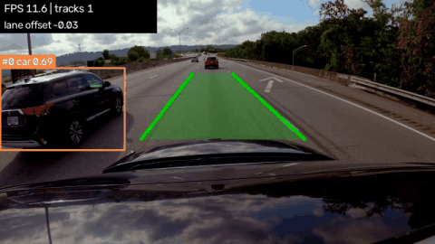
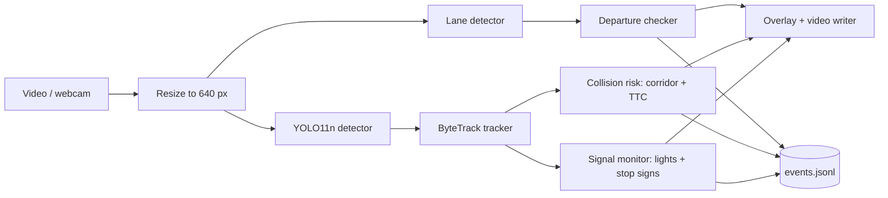

# DriveGuard AI

[](https://github.com/vanii042/driveguard-ai/actions/workflows/tests.yml)


A lightweight **ADAS (Advanced Driver-Assistance System) prototype** that watches dash-cam video and raises
driver alerts for **lane departure**, **forward collision risk**, **traffic lights** and **stop signs**.
It runs on an ordinary laptop CPU (no GPU, about 1 GB of RAM, mostly PyTorch) and every alert is also written to a
machine-readable event log.

   

   *Lane tracking, object tracking and driver alerts on dash-cam footage ([source](docs/images/data_sources.md)).*

## Features

| Feature | How it works | Output |
|---|---|---|
| **Object detection** | YOLO11 nano (COCO) for people, cyclists, cars, motorbikes, buses, trucks, traffic lights, stop signs | Boxes + labels |
| **Multi-object tracking** | ByteTrack gives each object a stable ID across frames | `#id` on each box |
| **Lane detection** | Classical CV: lane-paint mask (bright / yellow / brighter-than-road), Canny, Hough, temporal smoothing | Green lane overlay |
| **Lane-departure warning** | Offset from lane centre (as a fraction of lane width) with hysteresis so it does not flicker | `LANE DEPARTURE - LEFT/RIGHT` banner |
| **Forward-collision warning** | Ego-corridor test + time-to-collision (TTC) estimated from bounding-box growth | Box colour by risk level, `COLLISION RISK` / `BRAKE` banner |
| **Traffic-light state** | HSV colour vote inside the detected box, smoothed over several frames, picks the light ahead | `LIGHT: RED/YELLOW/GREEN` badge |
| **Stop-sign alert** | Fires once per sign when it is close enough (tall enough in the frame) | `STOP SIGN AHEAD` banner |
| **Event log** | Every alert is saved with frame number and video time | `outputs/events.jsonl` |
| **Per-stage profiling** | Average and p95 latency per pipeline stage, FPS and RAM | Printed run summary |

## Architecture



```
src/driveguard/
  config.py        typed YAML config with typo detection
  video_io.py      streaming frame reader (flat memory) and writer
  pipeline.py      per-frame chain: lanes, detection, tracking, risk, signs, events
  detection/       YOLO wrapper and the Detection type
  tracking/        ByteTrack behind our own Track interface
  lane/            lane detector and departure checker
  risk/            ego corridor + time-to-collision
  signs/           traffic-light colour and stop-sign logic
  events/          JSON Lines event log
  viz/             drawing helpers (pure functions)
configs/           default, highway and urban camera presets
scripts/           run_video, check_env, tune_lane, probe_video, make_demo_gif
tests/             71 tests (no video files or GPU needed)
`scripts/run_video.py` is a thin front-end over `driveguard.pipeline.Pipeline`, which can also be driven from tests with a scripted detector, so the full chain is tested without loading YOLO.
```

## Quick start (Windows, PowerShell)

```powershell
git clone https://github.com/vanii042/driveguard-ai.git
cd driveguard-ai
python -m venv .venv
.venv\Scripts\Activate.ps1
pip install -e ".[dev]"

python scripts\check_env.py                      # sanity-check the install
pytest                                           # run the tests

python scripts\run_video.py --source data\samples\highway_day.mp4 --config configs\highway.yaml
```

On macOS / Linux use `source .venv/bin/activate` and forward slashes. Run all commands from the project root.
The YOLO weights (about 5 MB) download automatically into `models/` on the first run.

**Sample footage** is not stored in the repo. Download clips from the Pexels links in
[`docs/images/data_sources.md`](docs/images/data_sources.md) into `data/samples/`, or point `--source` at any
dash-cam video. `--source 0` uses the webcam.

### Useful options

| Option | Meaning |
|---|---|
| `--config configs\urban.yaml` | Camera preset (lane ROI and ego corridor depend on where the camera is mounted) |
| `--debug` | Draw the lane region of interest, the edge map and the ego corridor, to tune a new camera |
| `--max-frames 200` | Stop early, handy for quick tests |
| `--show` | Live preview window (press `q` to quit) |
| `--output` / `--events` | Where to write the annotated video and the event log |

### Event log

Each alert is one line of JSON in `outputs/events.jsonl` (values below are illustrative):

```json
{"kind": "collision_critical", "frame": 41, "t": 1.367, "track_id": 0, "ttc": 0.94}
{"kind": "lane_departure", "frame": 212, "t": 7.067, "side": "right", "offset": 0.41}
{"kind": "traffic_light", "frame": 305, "t": 10.167, "state": "red", "track_id": 12}
{"kind": "stop_sign", "frame": 540, "t": 18.0, "track_id": 31}
```

## How the collision warning works

No camera calibration is needed. An approaching object's apparent width `w` scales as `1 / distance`, so with a
constant closing speed `d(ln w)/dt = 1 / TTC`. DriveGuard fits the slope of `ln w` over the last few frames and
takes its inverse as the time-to-collision. Two details keep it stable:

- The slope is a **Theil-Sen** estimate (median of pairwise slopes), so a single glitchy bounding box cannot
  fake an approach. A least-squares fit lets one bad frame trigger a false alert for the whole window.
- A risk level must hold for `confirm_frames` consecutive frames before it is reported.

An object only counts as "in path" when the point where it touches the road lies inside the **ego corridor**, a
trapezoid in front of the car. Levels: `caution` under 5 s, `warning` under 3 s, `critical` under 1.5 s
(all configurable in `configs/`).

## Configuration

All tunables live in YAML. `configs/default.yaml` holds the shared settings, and `highway.yaml` and `urban.yaml`
override only the camera-specific regions. Unknown or misspelled settings raise a clear error instead of being
silently ignored:

```
ConfigError: unknown setting(s) in 'risk': ttc_critcal. Valid settings: ...
```

## Performance

Measured on a Windows laptop (12th Gen Intel(R) Core(TM) i5-1235U), 818-frame highway clip, 640 px frames,
`imgsz` 416, YOLO11n:

| Stage | avg ms | p95 ms |
|---|---:|---:|
| decode + resize | 42.7 | 63.8 |
| lane detection | 12.4 | 20.2 |
| YOLO detection | 35.3 | 60.1 |
| tracking | 0.5 | 1.0 |
| collision risk | 0.1 | 0.1 |
| traffic lights / stop signs | <0.1 | <0.1 |
| draw + write | 3.9 | 5.8 |
| **end to end** | **10.5 FPS** | peak RAM about 880 MB (mostly PyTorch) |

Decoding is the largest cost here because the source clip is high resolution, so a 720p source is the easiest
speed-up. After that, a smaller `detector.imgsz` (for example 320) or `video.max_width` helps. Run the
script on your own footage to get your own numbers; it prints this table at the end of every run.

## Tests

```powershell
pytest
```

71 tests cover the config loader, lane detection (synthetic roads), departure hysteresis, tracker ID stability,
collision risk (including noise robustness), traffic-light colour voting, stop-sign alerts, the event log, the
overlays and the full `run_video.py` loop. They use synthetic frames, so no video files are needed. GitHub Actions runs them on Windows and Linux.

## Limitations (read before trusting it)

This is a **portfolio and learning project, not a safety system.**

- **TTC is a proxy.** It comes from bounding-box growth, not metric distance, so it assumes a roughly constant
  closing speed and a steady detector.
- **Lane detection is classical.** It works on clear, painted, mostly straight roads. Sharp curves, heavy
  shadows, worn paint, rain and night driving degrade it.
- **Presets are camera-specific.** The lane region and ego corridor must be tuned (use `--debug`) for each
  camera mount.
- **Traffic-light colour is a heuristic.** It was developed and tested on synthetic crops. Tiny, blown-out or
  backlit lights come back `UNKNOWN` rather than guessing. COCO has no speed-limit or other signs.
- **Single camera, CPU, 640 px.** That is the point of the design, but it limits range and small-object accuracy.

## Roadmap

- Validate traffic-light colour on real footage and report accuracy
- Evaluate lane detection against a labelled set (for example TuSimple or CULane samples)
- Optional ONNX / OpenVINO export for faster CPU inference
- Camera calibration for metric distance

## Make your own demo GIF

```powershell
python scripts\run_video.py --source data\samples\highway_day.mp4 --config configs\highway.yaml
python scripts\make_demo_gif.py --input outputs\annotated.mp4 --output docs\images\demo.gif --start 5 --seconds 8
```

Then point the image at the top of this README to `docs/images/demo.gif`.

## Credits

Detection by [Ultralytics YOLO11](https://github.com/ultralytics/ultralytics), tracking by
[`trackers`](https://github.com/roboflow/trackers) / [Supervision](https://github.com/roboflow/supervision).
Sample footage from Pexels, see [`docs/images/data_sources.md`](docs/images/data_sources.md).
